# Cardinal Conflict: Design Document

This document explains how the Godot 4.5 (C#) version of Cardinal Conflict is put together. It covers what each class is responsible for and how the classes work together.

---

## 1. The game in brief

- **Players:** 2–8 people share one machine and take turns (hot-seat).
- **Board:** 15×15 tiles, generated at random when a match starts:
  - 2 **pyramids** (objectives) for each player
  - about ⅓ **blockades** (levels I, II, III, VI and V)
  - about ⅑ **plus** / **minus** tiles
  - the rest **empty**
- **Cards:** a card is a small pattern of **targets**. Each target is aimed at a tile offset from where the card is cast, for example "origin on a tile you own + attack the tile to its right".
- **A player's turn:**
  1. The player is dealt cards.
  2. They may play up to *(pyramids owned + 1)* cards.
  3. "Instant" effects, such as capturing a neutral tile, happen as soon as a card is played. Every other effect waits.
- **End of a round:** once every player has had a turn, all played cards **resolve together** in four phases (see §6).
- **Elimination:** a player who owns no pyramids is eliminated.
- **Winning:** a player wins with 3 **victory points**, i.e. three owned pyramids whose four neighbours are also owned. If only one player is left alive, that player wins.

---

## 2. Project layout

| Path | Contents |
|---|---|
| `project.godot` | Engine settings: GL Compatibility renderer, nearest-neighbour texture filtering, a maximized window, and the **input map** (`cc_*` actions). |
| `scenes/Main.tscn` | The only scene: a single `Node` running `Main.cs`. Everything else is created in code. |
| `scripts/Core/` | `Main`, `Stage`, `HudCanvas`, `InputRouter`, `Assets`, `Palette` |
| `scripts/Stages/` | `MenuStage`, `GameStage` |
| `scripts/Board/` | `TileGrid<T>` and `Tile`, `CardinalTile`, `BoardView`, `TargetOverlay` |
| `scripts/Rules/` | `Player`, `CardinalCard`, `Target` and its subclasses, `Dealer` |
| `scripts/UI/` | `UIElement`, `MultiRenderUIElement`, `CardinalCardElement`, `TextDraw` |
| `assets/textures/` | The 9 sprites the game draws |

The code falls into three layers:

```
┌────────────────────────────────────────────────────────────┐
│ Engine glue    Main · Stage · HudCanvas · InputRouter      │  Godot nodes and input
├────────────────────────────────────────────────────────────┤
│ Presentation   MenuStage · GameStage · BoardView ·         │  screens, layout, drawing
│                TargetOverlay · UIElement family            │
├────────────────────────────────────────────────────────────┤
│ Rules          Player · CardinalCard · Target* · Dealer ·  │  plain C#, no Godot nodes
│                TileGrid<T> · CardinalTile                  │
└────────────────────────────────────────────────────────────┘
```

The rules layer only uses Godot's value types (`Vector2I`, `Rect2I`, `Color`). It never touches nodes, so the rules could be unit-tested or reused without the engine.

---

## 3. Runtime scene tree

At any time `Main` has exactly one stage child.

```
/root
└── Main                          (Main.cs: switches between stages)
    └── MenuStage | GameStage     (Stage subclass)
        ├── World      (Node2D)   world-space content
        │   └── Board  (BoardView, at (-500,-500), scale 5)     [GameStage only]
        │       └── TargetOverlay                               [GameStage only]
        ├── Camera     (Camera2D)
        └── Hud        (CanvasLayer, screen space)
            └── HudCanvas (Node2D, calls Stage.DrawHud)
```

---

## 4. Class diagram

```mermaid
classDiagram
    direction LR

    class Main {
        +CurrentStage : Stage
        +ShowMenu(cheat)
        +StartGame(players, cheat)
        +Quit()
    }
    class Stage {
        <<abstract>>
        +Game : Main
        +Camera : Camera2D
        +World : Node2D
        +UI : List~UIElement~
        +DrawHud(canvas)
        +Select() / SelectDown() / Back() / Menu()
        +Up() / Down() / Left() / Right()
        +MouseMove() / MousePress() / OtherButton()
        +StickLeftChange() / StickRightChange()
    }
    class MenuStage
    class GameStage {
        +Players : List~Player~
        +Board : BoardView
        +PlayedCards : List~CardinalCard~
        +SelectedTile / SelectedCard
        +StartPlayerTurn() / EndPlayerTurn()
        +EndPhase() / Win()
        +MoveCards() / ResetTurn()
    }
    class InputRouter {
        +Poll()
        +HandleEvent(e)
    }
    class HudCanvas
    class BoardView
    class TargetOverlay
    class TileGrid~T~ {
        +Tiles : T[,]
        +TileAt(pos)
        +AdjacentTiles(pos)
    }
    class Tile
    class CardinalTile {
        +CurrentType / InitialType
        +Owner : Player
        +Hit(player)
    }
    class Player {
        +Name / TeamColor / Dead
        +AttackHand / MagicHand
        +PyramidPoints / VictoryPoints / HandSize
    }
    class CardinalCard {
        +Targets : List~Target~
        +CastPoint
        +Play() / CastCheck()
        +Check() / Activate() / Resolve() / PostCheck()
    }
    class Target {
        <<abstract>>
        +RelativeTarget : Vector2I
        +CastCheck(tile)
        +Activate(tile)
    }
    class Dealer {
        <<static>>
    }
    class UIElement {
        <<abstract>>
        +Render(canvas)
    }
    class MultiRenderUIElement
    class CardinalCardElement

    Main o-- "1" Stage : current
    Stage <|-- MenuStage
    Stage <|-- GameStage
    Stage *-- InputRouter
    Stage *-- HudCanvas
    Stage o-- UIElement
    InputRouter ..> Stage : calls commands
    HudCanvas ..> Stage : DrawHud
    MenuStage ..> Main : StartGame
    GameStage ..> Main : ShowMenu / StartGame / Quit
    GameStage *-- BoardView
    BoardView *-- TargetOverlay
    BoardView o-- TileGrid~T~
    TargetOverlay ..> GameStage : reads state
    TileGrid~T~ o-- Tile
    Tile <|-- CardinalTile
    CardinalTile --> Player : Owner
    GameStage o-- Player
    GameStage o-- CardinalCard : played this round
    Player o-- CardinalCardElement : hands
    CardinalCardElement --> CardinalCard
    CardinalCard *-- Target
    Target --> CardinalCard : MasterCard
    UIElement <|-- MultiRenderUIElement
    UIElement <|-- CardinalCardElement
    Dealer ..> CardinalCard : creates
    GameStage ..> Dealer
    CardinalTile ..> Dealer : blockade reward
```



---

## 5. Class reference

### 5.1 Engine glue (`scripts/Core`)

#### `Main` (Node, formerly `GameBase`)
The root of the game. It owns exactly one active `Stage`.
- `ShowMenu()` creates a `MenuStage`.
- `StartGame(players)` creates a `GameStage`.
- `SwapStage`: the old stage is disabled at once (so it cannot react to the rest of this frame's input) and freed at the end of the frame.
- `Quit()` exits the application.
- **Called by:** `MenuStage` ("Start Game") and `GameStage` (the victory screen buttons).

#### `Stage` (abstract Node2D)
The base for one screen. In `_Ready` it builds the World node, the `Camera2D`, the HUD `CanvasLayer` with its `HudCanvas`, and an `InputRouter`.

What it provides:
- **Camera:** the camera always shows **1600 world units vertically**. Its zoom is `viewportHeight / 1600`, recalculated every frame, so the board looks the same at any resolution.
- **UI list:** a list of `UIElement`s, drawn by the default `DrawHud`.
- **Virtual commands:** `Select`, `SelectDown`, `Back`, `Menu`, `Up/Down/Left/Right`, `MouseMove`, `MousePress`, `OtherButton(ExtraButton)`, `StickLeftChange`, `StickRightChange`. `InputRouter` calls these, and subclasses override the ones they care about.
- **Helpers:** `FindUIByString`, `ShowMouse`, `ViewportSize`, and `IsCurrent` (true while this is the stage `Main` is showing).

#### `HudCanvas` (Node2D)
A screen-space drawing surface on the stage's `CanvasLayer`. Its `_Draw()` just calls `Stage.DrawHud(this)`, so each stage draws its HUD in one ordered place.

#### `InputRouter` (plain C#, formerly `InputHandler`)
Turns raw input into the stage's virtual commands. It does no game logic of its own.
- `Poll()` runs every frame from `Stage._Process`:
  - It reads the `cc_*` actions with just-pressed / just-released edges.
  - It reads both sticks with `Input.GetVector`, and reports a stick only when its value changes.
  - It does nothing while the window is unfocused.
- `HandleEvent()` handles mouse motion, wheel and left-button **release** (clicks count on release, as in the original).
- Every command goes through `Fire()`. It drops the command if the stage stopped being current earlier in the same frame, for example because "Start Game" was just pressed.

| Action (`project.godot`) | Keyboard | Gamepad | Stage command |
|---|---|---|---|
| `cc_select` | Enter, keypad Enter | A | `SelectDown` on press, `Select` on release |
| `cc_back` | Backspace | B | `Back` (on release) |
| `cc_menu` | Esc | Start | `Menu` (on release) |
| `cc_swap_hand` | Tab | Back, LB | `OtherButton(SwapHand)` (on release) |
| `cc_previous_card` | *(mouse wheel up)* | RB | `OtherButton(PreviousCard)` |
| `cc_next_card` | *(mouse wheel down)* | RT | `OtherButton(NextCard)` |
| `cc_up/down/left/right` | Arrow keys | D-pad | `Up/Down/Left/Right` |
| `cc_move_*` | — | Left stick | `StickLeftChange` |
| `cc_scroll_*` | — | Right stick | `StickRightChange` |

#### `Assets` (static)
The one place where textures and the font are loaded (`res://assets/textures/*.png`, plus Godot's fallback font). It replaces the MonoGame `Content.Load` calls.

#### `Palette` (static)
Exact 8-bit versions of the XNA named colours the game uses, and the list of 8 team colours. Godot's own `Colors.Green`, `Purple` and `Gray` are different colours, so these constants keep the original look.

### 5.2 Stages (`scripts/Stages`)

#### `MenuStage`
The player setup screen.
- **Elements:** a "Welcome!" banner, a name box (`SelectString = "name"`), and three selectable buttons:

  | Tab index | Button | Action string |
  |---|---|---|
  | 0 | Color | `"color"` |
  | 1 | New Player | `"next"` |
  | 2 | Start Game | `"play"` |

- **Focus:**
  - The `CurrentIndex` property moves the green selection border onto the element with that tab index. Going past either end wraps around.
  - Arrow keys or the D-pad move focus.
  - Hovering the mouse focuses a button, and clicking it activates it.
- **Name entry:** `_UnhandledInput` reads `InputEventKey.Unicode`. It accepts letters, digits and spaces up to 16 characters, and Backspace deletes.
- **`PushContext(action)`:**
  - `"color"` cycles through the colours nobody has taken yet.
  - `"next"` creates a `Player`, adds a coloured name plate on the left, and removes that colour from the pool. The limit is 8 players.
  - `"play"` calls `Main.StartGame` once there are at least 2 players.
- `Cheats.Rainbow`, if passed in, starts the game with every tile randomly owned. It is a debug aid and nothing in the UI turns it on.

#### `GameStage`
A match. It is the central coordinator.

**Setup (`_Ready`)**
1. Create a `TileGrid<CardinalTile>` and register it as `Player.Map` and `CardinalCard.Map`.
2. `GenerateBoard` fills and shuffles the tiles and caches each tile's `AdjacentTiles`.
3. Create a `BoardView` (with its `TargetOverlay`) under `World`.
4. Call `StartPlayerTurn()`.

**States (`GameState`)**

| State | What is happening |
|---|---|
| `StartMenu` | A modal button is showing: "<name>, Your turn!" or "End Turn?" |
| `Ingame` | The player is moving the cursor and playing cards |
| `Victory` | The results and the restart, new game and exit buttons |

Setting `State` clears all `MultiRenderUIElement`s. Each state then adds its own buttons.

**Turn flow**

```
StartPlayerTurn ─► (StartMenu) "<name>, Your turn!" ─► Ingame
      ▲                                                  │  play cards (TryPlaySelectedCard)
      │                                                  │  Backspace: ResetTurn
      │                                                  ▼
NextPlayer ◄── EndPlayerTurn ◄── "End Turn?" (StartMenu, opened with Esc / Start)
      │
      └─ after the last player ─► EndPhase ─► Victory?  or  next round
```

- **`StartPlayerTurn`:**
  - Skips dead players.
  - In the first two rounds (`Turn <= 1`), deals a single *capture-triangle* card, which is used to claim a starting pyramid.
  - In later rounds, deals one **upkeep** magic card (`Dealer.DrawUpkeep`) plus `HandSize` **attack** cards (`Dealer.DrawAttack`).
  - Sets the play allowance from the player's pyramid count. The counter next to the hand shows how many plays are left.
- **`TryPlaySelectedCard`:**
  - Checks that the player has a card, that `CardinalCard.CastCheck` passes at the selected tile, and that plays remain.
  - Calls `card.Play` (instant effects), moves the card to `PlayedCards`, removes it from the hand, and swaps hands automatically if the hand is now empty.
- **`ResetTurn`** (Backspace or B) takes back all of this player's played cards and `Reverse`s their instant effects.
- **`EndPlayerTurn`** throws away any unplayed **attack** cards. Magic cards are kept between turns.
- **`EndPhase`:**
  1. Runs the four resolution phases over every played card (§6) and clears `PlayedCards`.
  2. Eliminates players with 0 pyramids.
  3. Declares winners: anyone with at least 3 victory points, or the last player alive.
  4. Sorts `Players` by score (`Player.CompareTo`). The turn order for the next round follows this sort.

**Hand layout (`MoveCards`)**
- The current hand runs down the right edge, with the selected card at double size.
- The off-hand runs along the bottom-left.
- All sizes are fractions of the viewport height. The layout is redone after any change and whenever the window is resized.

**HUD (`DrawHud`)**
Drawn in this order:
1. UI elements
2. the scoreboard plates (top-left)
3. the current player's banner (top-centre)
4. the plays-remaining counter
5. the cards
6. the selection border (only while a modal is showing)

**Camera**
- While `Ingame`, the camera scrolls when the mouse is within 10% of an edge, or with the right stick. It is clamped to the board's world bounds.
- `MoveCursor` re-centres the camera on the cursor if the cursor goes off-screen.

**Input commands**
- Arrow keys and the D-pad move the board cursor, or move menu focus while a modal is open.
- `Select` and `MousePress` play cards, or press the focused button.
- `OtherButton` browses or swaps the hands.
- `Back` resets the turn.
- `Menu` opens or closes "End Turn?".

### 5.3 Board (`scripts/Board`)

#### `TileGrid<T>` and `Tile` (formerly `TileMap<T>`, renamed to avoid clashing with Godot's `TileMap`)
`TileGrid<T>` is a plain 2D array of tiles.
- The indexer throws when out of range.
- Setting a tile through the indexer also sets its `Position`.
- `TileAt` returns null when off the board.
- `AdjacentTiles` returns up to 4 orthogonal neighbours.

`Tile` holds the shared per-cell data: `Position`, `TileValue` (the sprite index) and `Color` (the tint).

#### `CardinalTile` : `Tile`
The game-specific tile.
- **`CurrentType`** is one of: `Empty`, `Upgrade` (plus), `Downgrade` (minus), `Blockade_I`, `II`, `III`, `VI`, `V`, or `Objective` (pyramid). Setting it also picks the sprite from the sheet:

  | Sheet index | Tile |
  |---|---|
  | 0 | empty |
  | 1 | plus |
  | 2 | minus |
  | 3 | pyramid |
  | 4–8 | blockade levels |

- **The enum order matters.** Fortify uses `++` and hits use `--`, so the blockade levels must stay in that order (including the original "VI before V" naming).
- **`InitialType`** is the terrain the tile started as.
- **`Owner`:** setting it re-tints the tile with the owner's team colour.
- **`Hit(player)`** lowers a blockade by one level. At level I the blockade is destroyed:
  - A blockade *built* on a terrain tile (by Fortify) returns to that terrain.
  - A blockade *generated with the map* gives the hitter a reward card (`Dealer.DrawBlockade`) and becomes random terrain.

#### `BoardView` (Node2D)
Draws the grid in world space.
- **Placement:** each tile is 32 local units. The node is placed at (-500,-500) with scale 5, so a tile is 160 world units.
- **Drawing:** each tile is drawn from `Assets.TileSheet`, tinted with `Tile.Color`.
- **Coordinate helpers:**
  - `LocalTileRect`, `WorldTilePosition` and `TilePositionAtLocal` convert between tile and node coordinates.
  - `TileUnderMouse` uses `GetLocalMousePosition()`, so the camera transform is handled for free.
  - `WorldBounds` gives the board's extent for camera clamping.

#### `TargetOverlay` (Node2D, child of `BoardView`, formerly `Cursor`)
Draws markers in the board's local space, using sprites from `Assets.TargetOverlayIcons`:
- every target of every card played this round, tinted with the caster's colour;
- a preview of the selected card at the hovered tile: the white target icon where that target is valid, and a crossed-out circle where it is not;
- a plain cursor circle when the hand is empty.

It reads `GameStage.PlayedCards`, `SelectedTile`, `SelectedCard` and `CurrentPlayer`, and never changes them.

### 5.4 Rules (`scripts/Rules`)

#### `Player`
- **Identity:** `Name`, `TeamColor` (grey when dead) and `TextColor`.
- **Hands:** an `AttackHand` and a `MagicHand`. `CurrentHand` chooses which one is `Hand` (browsed and played from) and which one is `OffHand`.
- **Scores** are derived from `Player.Map` every time they are read:
  - `PyramidPoints`: pyramids owned.
  - `VictoryPoints`: owned pyramids whose 4 neighbours are also owned.
  - `HandSize`: 1, plus 1 for each plus tile, minus 1 for each minus tile, never below 1.
- `CompareTo` ranks players by victory points, then pyramids, then hand size, all descending.

#### `CardinalCard`
- A card has an owner, a `CardType` (`Attack` or `Magic`; this only changes the frame and the hand it goes to) and a list of `Target`s. `AddTarget` links each target back to the card (`MasterCard`).
- **`CastCheck(tile)`:** every target's tile (`tile + RelativeTarget`) must be on the board and pass that target's own `CastCheck`.
- **`Play(tile)`:** records `CastPoint` and runs `Cast` on every `IInstantCastable` target.
- **Resolution phases:** `Check`, `Activate`, `Resolve` and `PostCheck` are called by `GameStage.EndPhase`. Each looks up its targets' tiles through the static `CardinalCard.Map`.
- **`UI`:** the card's `CardinalCardElement`, created on first use. The hands store these elements, not the cards.

#### `Target` and its subclasses (`Target.cs`)
`Target` is the base class for one effect. It has:
- `RelativeTarget`: the offset from the cast point;
- `IconRegion`: its icon on the card;
- `MapRegion`: its marker on the board;
- `CastCheck`, which decides validity;
- a virtual `Activate`.

A target joins the other resolution phases by implementing an interface:

| Interface | Method | When it runs |
|---|---|---|
| `IInstantCastable` | `Cast` / `Reverse` | When the card is played, and undone by "reset turn" |
| `IPreActivatable` | `Check` | Phase 1 |
| *(base)* | `Activate` | Phase 2 (every target) |
| `IResolvable` | `Resolve` | Phase 3 |
| `IPostResolvable` | `FinalCheck` | Phase 4 |

| Target | Valid when | Effect |
|---|---|---|
| `OriginTarget` | You own the tile | None. It anchors directional cards. |
| `AttackTarget` | The tile exists | **Activate:** a blockade is hit; any other tile changes hands to you. **FinalCheck:** if this took a pyramid and the victim has no pyramids left, you get 3 random magic cards. |
| `CaptureTarget` | The tile is unowned and not a blockade | **Instant:** you own it. |
| `CaptureTriangleTarget` | The tile is unowned, not a blockade, and is a pyramid or next to a tile you own | **Instant:** you own it. |
| `StrikeTarget` | The tile is a blockade next to a tile you own | **Activate:** the blockade is hit. |
| `BurnTarget` | The tile is owned and is empty, minus or a blockade | **Activate:** the tile becomes neutral (and a blockade is also hit). |
| `FortifyTarget` | You own the tile and it is not already at the top blockade level | **Check:** it becomes a level-I blockade, or a blockade goes up one level. |
| `DefenceTarget` | Always | **Instant:** remembers the tile's owner. **Resolve:** gives the tile back to that owner, undoing any attack on it this round. |

#### `Dealer` (static)
Every card is created here:

| Method | Gives |
|---|---|
| `DrawAttack` | origin + attack on a random side |
| `DrawUpkeep` | one magic card per turn, chosen by victory points: 0 → Strike, 1 → Capture-triangle, 2 or more → Fortify |
| `DrawBlockade` | a reward chosen by the destroyed blockade's level (two options each) |
| `DrawRandomMagic` | one of 8 magic cards, including the three-target origin + side + diagonal attack |

### 5.5 UI (`scripts/UI`)

#### `UIElement` (abstract)
Anything that draws itself on the HUD: `Render(CanvasItem)`.

#### `MultiRenderUIElement`
A textured box with optional centred black text.
- **Placement:** in pixels (`RenderType.Pixel`) or as fractions of the viewport (`RenderType.Percentage`). A `ViewportSize` delegate lets it re-lay itself out when the window changes size.
- **Tint:** `RenderColor`.
- **Text size:** `TextScale` sets the text's line height as a fraction of the box height.
- **Navigation:** `Selectable`, `TabIndex` and `SelectString` make it a button that keyboard, gamepad and mouse can reach. `SelectString` names the action, which the owning stage interprets.
- **Selection border:** `CopyLayoutFrom` moves the green selection border onto another element.

#### `CardinalCardElement`
Draws a card in this order:
1. the background (tinted gold for magic cards);
2. one icon for each target, on a grid that fits `(2·MaxRadius + 1)` cells across 80% of the card;
3. the frame (red for attack, silver for magic).

`GameStage.MoveCards` sets its `Rect`.

#### `TextDraw` (static)
Bridges XNA-style text drawing (anchored at the top-left and sized by a scale) to Godot's `DrawString` (anchored at the baseline and sized in pixels):
- `SizeForLineHeight` picks the font size whose line height matches a pixel height.
- `DrawTopLeft` and `DrawCentered` place the text.

---

## 6. Round resolution in detail

`GameStage.EndPhase` runs each phase over **all** played cards before starting the next phase. Effects therefore combine in a fixed order, whoever played first:

1. **Check** (`IPreActivatable`): Fortify raises blockades *before* attacks land, so a fortified tile resists this round's attacks.
2. **Activate** (every target): attacks change tile owners or hit blockades, strikes hit blockades, and burns make tiles neutral.
3. **Resolve** (`IResolvable`): Defence gives tiles back to the owners they had when the defence card was played.
4. **PostCheck** (`IPostResolvable`): attack bonuses for eliminating a player's last pyramid.

After that, players with no pyramids are eliminated. A player with ≥3 victory points, or the last player standing, wins. Otherwise `Players` is re-sorted by score and the next round begins.

---

## 7. Rendering and coordinate spaces

| Space | Who uses it | Units |
|---|---|---|
| **Board-local** | `BoardView`, `TargetOverlay` | 32 per tile; tile (x,y) covers `[32x, 32y]–[32x+32, 32y+32]` |
| **World** | `World` node, `Camera2D` | 160 per tile. The board spans (-500,-500) to (1900,1900). The camera shows 1600 units vertically. |
| **Screen** | `HudCanvas` (on a `CanvasLayer`), `UIElement`s | Viewport pixels. `Percentage` elements scale with the window. |

Textures use nearest-neighbour filtering (set in the project settings) to keep the pixel-art look. The window opens maximized with stretching disabled. The layout code reads the viewport size directly, as the original did.

---

## 8. MonoGame → Godot migration map

| Original (MonoGame) | Godot version | Notes |
|---|---|---|
| `Program.cs`, `Game` loop | `scenes/Main.tscn` + `Main` | Godot owns the main loop. |
| `GameBase` | `Main` | The menu UI construction moved into `MenuStage`. |
| `Stage` | `Stage` (Node2D) | It now owns a Camera2D, the World node and the HUD layer. |
| `MenuStage`, `GameStage` | same names | The logic is ported closely. Draw code targets `CanvasItem`. |
| `InputHandler` | `InputRouter` + input map | XNA state diffing became Godot actions and events. `Buttons` became `ExtraButton`. |
| `Camera` | `Camera2D` | Zoom = viewport height / 1600, the same projection as before. |
| `Entity`, `RenderEntity`, `IRenderable`, `IInitializable`, `ISimpleUpdate` | `Node2D` / `_Draw` / `_Process` | Godot's node system replaces them. |
| `TileMap<T>` | `TileGrid<T>` (data) + `BoardView` (drawing) | Renamed to avoid Godot's `TileMap`. Data and rendering are now separate. |
| `Cursor` | `TargetOverlay` | |
| `UIElement`, `MultiRenderUIElement`, `CardinalCardElement` | same names | `SpriteBatch` became `CanvasItem` draw calls. Text goes through `TextDraw`. |
| `CardinalCard`, `Target`*, `Dealer`, `Player`, `CardinalTile` | same names | `Point` → `Vector2I`, `Rectangle` → `Rect2I`, `Color` → `Palette`. |
| `Content.Load("bin\\Windows\\…")` | `Assets` | |
| SpriteFont "Ariel" (12pt Arial) | Godot fallback font | The compiled font was never in the repository. |
| `CardinalReplay`, `Statistics`, `ChangeResolution`/`ShrinkResolution`/`toggleBoarder`, `UndoLastPlay` | removed | They were empty or never called. |
